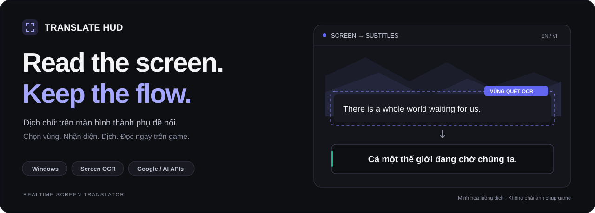
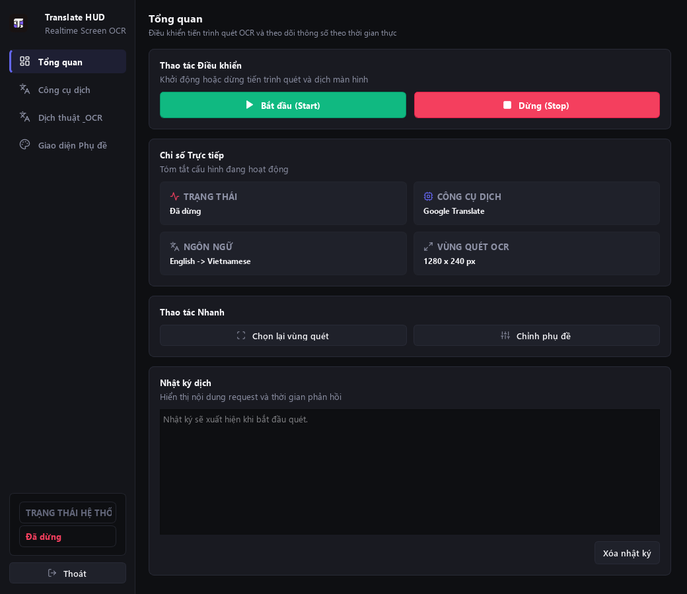
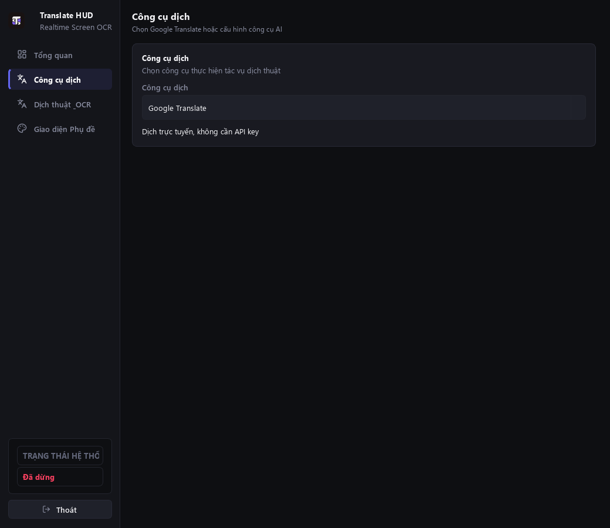
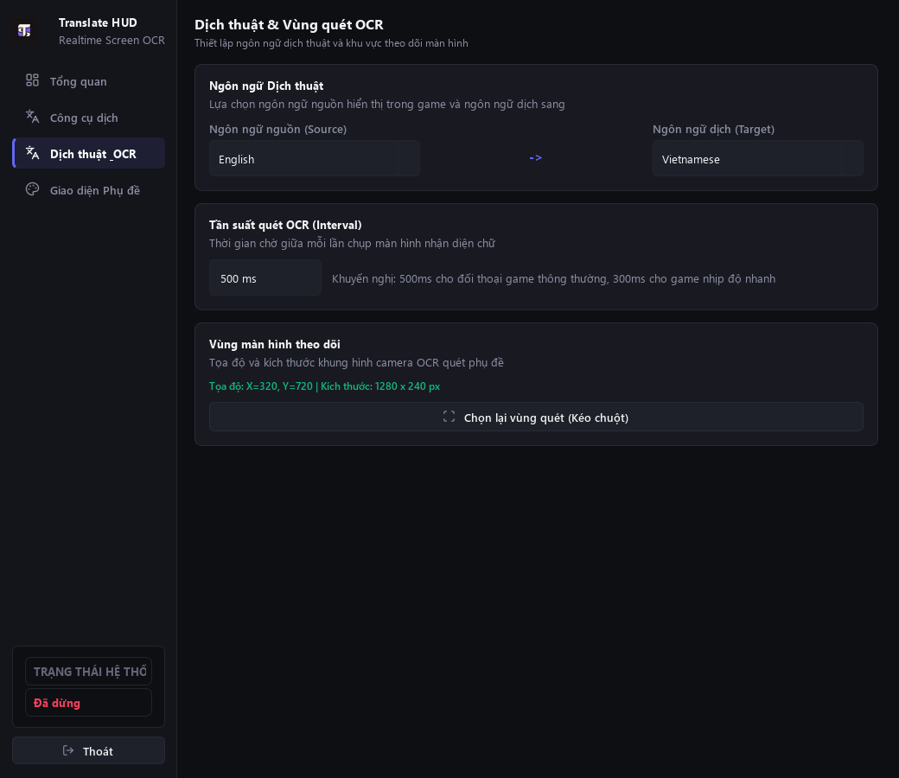
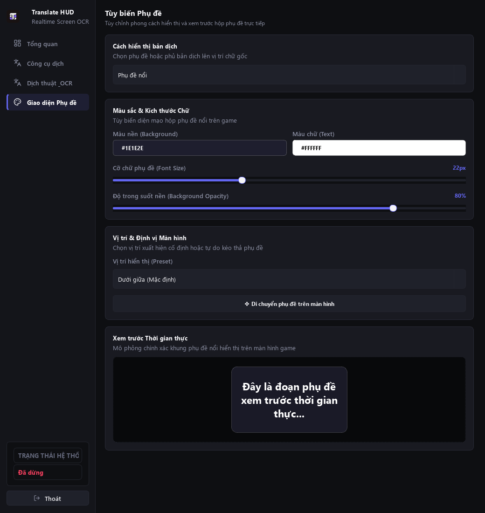
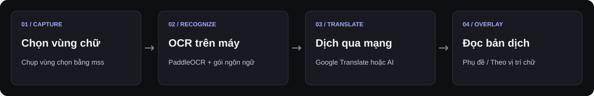

<p align="center">
  
</p>

<h1 align="center">Translate HUD</h1>

<p align="center">
  <strong>Đọc hiểu hội thoại game, ngay trên màn hình của bạn.</strong><br>
  Ứng dụng Windows nhận diện chữ trong vùng chọn và hiển thị bản dịch bằng overlay.
</p>

<p align="center">
  <code>Windows x64</code> · <code>Python 3.10</code> · <code>PyQt5</code> · <code>PaddleOCR</code>
</p>

<p align="center">
  <a href="#giao-diện">Giao diện</a> ·
  <a href="#tính-năng">Tính năng</a> ·
  <a href="#cài-đặt">Cài đặt</a> ·
  <a href="#sử-dụng">Sử dụng</a> ·
  <a href="#phát-triển">Phát triển</a>
</p>

---

## Giới thiệu

**Translate HUD** giúp bạn đọc chữ trên game hoặc ứng dụng mà không phải sao chép từng câu sang công cụ dịch. Kéo chọn vùng cần đọc, chọn ngôn ngữ và bắt đầu: ứng dụng chụp vùng màn hình, nhận diện chữ bằng OCR rồi đưa bản dịch lên phụ đề nổi hoặc lên vị trí chữ gốc.

Mặc định dùng **Google Translate, không cần API key**. Bạn cũng có thể chọn Google Gemini, OpenAI, DeepSeek hoặc Custom API tương thích OpenAI trong giao diện.

## Giao diện

### Bảng điều khiển

Theo dõi trạng thái, công cụ dịch, cặp ngôn ngữ và vùng quét; bắt đầu hoặc dừng ngay trên một màn hình.

<p align="center">
  <a href="assets/readme/dashboard.png">
    
  </a>
</p>

<details>
<summary><strong>Xem công cụ dịch, thiết lập OCR và tùy biến phụ đề</strong></summary>

### Công cụ dịch

Chọn Google Translate hoặc nhà cung cấp AI. Các trường model và API key thay đổi theo công cụ đã chọn.



### Dịch thuật & OCR

Thiết lập ngôn ngữ nguồn, ngôn ngữ đích, chu kỳ quét và vùng màn hình cần theo dõi.



### Tùy biến phụ đề

Chỉnh màu nền, màu chữ, cỡ chữ, độ trong suốt và vị trí; xem trước ngay trong ứng dụng.



</details>

*Ảnh được kết xuất từ các widget hiện tại với cấu hình mẫu, ở trạng thái dừng. Banner là hình minh họa luồng dịch.*

## Tính năng

| Tính năng | Bạn có thể làm gì? |
| :--- | :--- |
| **Quét theo vùng** | Kéo chọn khu vực chứa hội thoại, phụ đề hoặc chữ cần dịch. |
| **Nhiều công cụ dịch** | Chọn Google Translate, Google Gemini, OpenAI, DeepSeek hoặc Custom API. |
| **Hai cách hiển thị** | Dùng phụ đề nổi hoặc bản dịch theo vị trí chữ gốc. |
| **Tùy biến phụ đề** | Điều chỉnh màu sắc, cỡ chữ 14–36 px, độ trong suốt và vị trí. |
| **Chủ động tần suất quét** | Đặt chu kỳ 100–3000 ms; mặc định 500 ms. Đây là chu kỳ quét, không phải cam kết độ trễ dịch. |
| **Điều khiển khi chơi game** | Dùng phím tắt toàn hệ thống, thanh điều khiển nổi và biểu tượng khay hệ thống. |
| **Quản lý gói OCR** | Kiểm tra trạng thái các gói; tải thêm bộ nhận diện tiếng Trung và tiếng Hàn. |
| **Lưu API key** | Lưu bằng Windows DPAPI hoặc chỉ dùng trong phiên hiện tại. |

### Ngôn ngữ

| Vai trò | Hỗ trợ |
| :--- | :--- |
| **Nguồn OCR** | English, Japanese, Chinese, Korean |
| **Đích dịch** | Vietnamese, English |
| **Gói OCR đi kèm bản đóng gói đầy đủ** | English, Japanese |
| **Gói OCR tải thêm** | Chinese, Korean — cần cài trong trình quản lý gói ngôn ngữ |

## Cách hoạt động



OCR xử lý ảnh trên máy sau khi có đủ model. Phần dịch gửi **văn bản nhận diện được** đến công cụ bạn chọn và cần kết nối mạng. Thời gian phản hồi phụ thuộc vùng quét, CPU, mạng và nhà cung cấp dịch.

## Cài đặt

### 1. Chuẩn bị môi trường

Dùng **Windows x64, Python 3.10 x64** và Git. Bộ thư viện PaddleOCR/PaddlePaddle được ghim phiên bản trong [requirements.txt](requirements.txt); nên tạo môi trường riêng bằng Python 3.10.

Các bước dưới dùng nhánh `develop`, nơi có công cụ chuẩn bị OCR và bộ kiểm thử. Nhánh `main` chứa mã chạy ứng dụng cùng README và ảnh giới thiệu.

Chạy trong PowerShell:

```powershell
git clone --branch develop https://github.com/DoThanhBinh09052004/Realtime_Translator_Sreen.git
cd Realtime_Translator_Sreen

py -3.10 -m venv .venv
.\.venv\Scripts\python.exe -m pip install -r requirements.txt
```

### 2. Chuẩn bị model OCR

**Bản clone chỉ chứa metadata OCR, không chứa trọng số model.** Đường chạy ứng dụng hiện tại dùng trình quản lý gói và cần tài nguyên trong `assets/ocr/`. Chỉ cài thư viện Python chưa đủ để bắt đầu OCR.

Nếu chưa có model, khởi tạo English và Japanese để PaddleOCR tải vào cache trên máy:

```powershell
.\.venv\Scripts\python.exe -c "from paddleocr import PaddleOCR; [PaddleOCR(lang=lang, ocr_version='PP-OCRv4', use_angle_cls=False, show_log=False) for lang in ('en', 'japan')]"
```

Sau đó chuẩn bị model, từ điển và catalog. Lệnh dưới dùng thư mục cache mặc định của PaddleOCR; thay `--source-cache` nếu bạn đã cấu hình nơi lưu khác. Thư mục đầu ra `scratch/ocr-assets` phải chưa tồn tại.

```powershell
.\.venv\Scripts\python.exe tools/prepare_ocr_models.py `
  --source-cache "$env:USERPROFILE/.paddleocr" `
  --output scratch/ocr-assets `
  --pack-catalog assets/ocr/language-packs.json

Copy-Item -Path .\scratch\ocr-assets\* -Destination .\assets\ocr\ -Recurse -Force
```

Chỉ chạy lệnh sao chép khi công cụ chuẩn bị model hoàn tất thành công. Trọng số model được Git bỏ qua. Xem thêm [hướng dẫn chuẩn bị và đóng gói OCR](https://github.com/DoThanhBinh09052004/Realtime_Translator_Sreen/blob/develop/docs/testing/windows-ocr-bundle.md).

### 3. Mở ứng dụng

```powershell
.\.venv\Scripts\python.exe main.py
```

## Sử dụng

1. Mở **Công cụ dịch**. Giữ Google Translate để bắt đầu không cần key, hoặc chọn công cụ AI và lưu API key của bạn. Với Custom API, nhập thêm base URL tương thích OpenAI.
2. Mở **Dịch thuật & OCR**, chọn ngôn ngữ nguồn và ngôn ngữ dịch. Kiểm tra gói OCR tương ứng đã sẵn sàng; cài gói tải thêm nếu dùng Chinese hoặc Korean.
3. Bấm **Chọn lại vùng quét**, kéo chuột quanh khu vực chứa chữ. Chọn vùng gọn giúp tránh nhận diện nội dung không cần thiết.
4. Mở **Giao diện Phụ đề**, chọn **Phụ đề nổi** hoặc **Theo vị trí chữ**, rồi chỉnh kiểu hiển thị.
5. Trở về **Tổng quan**, bấm **Bắt đầu**. Dùng **Dừng** hoặc phím tắt để kết thúc phiên quét.

### Phím tắt Windows

| Phím | Thao tác |
| :--- | :--- |
| <kbd>Ctrl</kbd> + <kbd>Alt</kbd> + <kbd>F8</kbd> | Bật / dừng dịch |
| <kbd>Ctrl</kbd> + <kbd>Alt</kbd> + <kbd>F9</kbd> | Chọn lại vùng quét |

Nếu phím tắt bị ứng dụng khác chiếm, dùng bảng điều khiển hoặc menu khay hệ thống. Đóng cửa sổ điều khiển có thể thu ứng dụng xuống khay; chọn **Thoát** để kết thúc.

### Khi gặp vấn đề

| Hiện tượng | Cách xử lý |
| :--- | :--- |
| Gói English/Japanese chưa sẵn sàng | Với mã nguồn, thực hiện bước chuẩn bị model OCR. Với bản đóng gói, kiểm tra đã chép đủ thư mục ứng dụng. |
| Không nhận được chữ | Kiểm tra ngôn ngữ nguồn, trạng thái gói và chọn lại vùng quét sát nội dung cần đọc. |
| Google Translate tạm dừng | Kiểm tra mạng và thông báo trong **Tổng quan**; dùng **Thử lại** khi nút xuất hiện. |
| Công cụ AI báo lỗi | Kiểm tra API key, model, hạn mức và base URL nếu dùng Custom API. |
| Overlay không hiện trên game | Thử chế độ cửa sổ hoặc borderless. Khả năng hoạt động ở exclusive fullscreen cần kiểm tra riêng từng game. |
| Overlay theo vị trí chữ không có trong bản ghi | Chế độ này có thể bị loại khỏi ảnh chụp hoặc bản ghi màn hình. |

Ứng dụng hoạt động bằng chụp màn hình và cửa sổ overlay; không có cơ chế can thiệp vào tiến trình game. Chất lượng OCR phụ thuộc phông chữ, độ tương phản và kích thước chữ.

## Phát triển

`main` chứa mã chạy hệ thống; `develop` có thêm test, công cụ và tài liệu kỹ thuật. Cây thư mục dưới đây mô tả nhánh `develop`. Khi phát hành, đưa các thay đổi mã chạy đã kiểm thử sang nhánh release dựa trên `main`, rồi tạo PR vào `main`; giữ test và công cụ phát triển trên `develop`.

```text
main.py                 Khởi tạo và kết nối các thành phần
core/                   Cấu hình, worker, gói ngôn ngữ, xử lý hội thoại
engines/                OCR và các dịch vụ dịch
ui/                     Bảng điều khiển, overlay, chọn vùng, phím tắt
assets/ocr/             Catalog, manifest và tài nguyên OCR cục bộ
assets/readme/          Banner, sơ đồ và ảnh giao diện cho README
tests/                  Kiểm thử tự động
tools/                  Chuẩn bị model, đóng gói và công cụ kiểm tra
docs/testing/           Hướng dẫn xác minh các chức năng
```

### Chạy kiểm thử

```powershell
.\.venv\Scripts\python.exe -m pip install -r requirements-dev.txt
.\.venv\Scripts\python.exe -m pytest
```

Bộ kiểm thử mặc định dùng OCR và dịch giả lập, chặn mạng và chụp màn hình thật. Xem [cơ chế cô lập kiểm thử](https://github.com/DoThanhBinh09052004/Realtime_Translator_Sreen/blob/develop/docs/testing/isolation.md). Kiểm thử tích hợp với game, dịch vụ thật và bản đóng gói cần chạy riêng.

### Đóng gói Windows

Xem [hướng dẫn Windows OCR bundle](https://github.com/DoThanhBinh09052004/Realtime_Translator_Sreen/blob/develop/docs/testing/windows-ocr-bundle.md) để tạo môi trường build riêng, chuẩn bị model và chạy `tools/build_windows.ps1`. Bản one-folder phải được phân phối đầy đủ cùng tài nguyên, không chỉ riêng tệp `.exe`.

### Đóng góp

Bạn có thể [báo lỗi hoặc đề xuất tính năng](https://github.com/DoThanhBinh09052004/Realtime_Translator_Sreen/issues). Khi báo lỗi, ghi rõ phiên bản Windows/Python, công cụ dịch, ngôn ngữ nguồn và các bước tái hiện. Kiểm tra nhật ký, ảnh chụp trước khi đính kèm để tránh chia sẻ API key hoặc nội dung riêng tư.

---

<p align="center">
  <strong>Translate HUD</strong><br>
  Chọn vùng chữ. Đọc bản dịch. Tiếp tục cuộc chơi.
</p>
