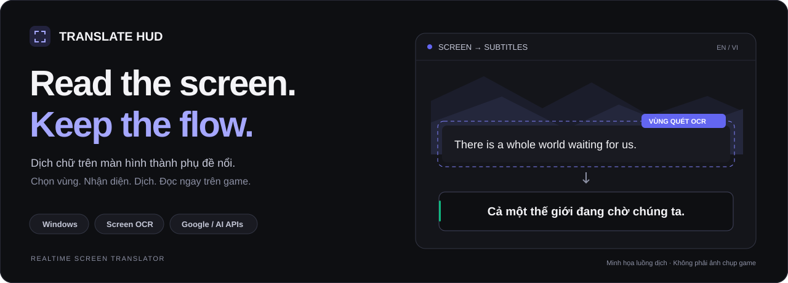
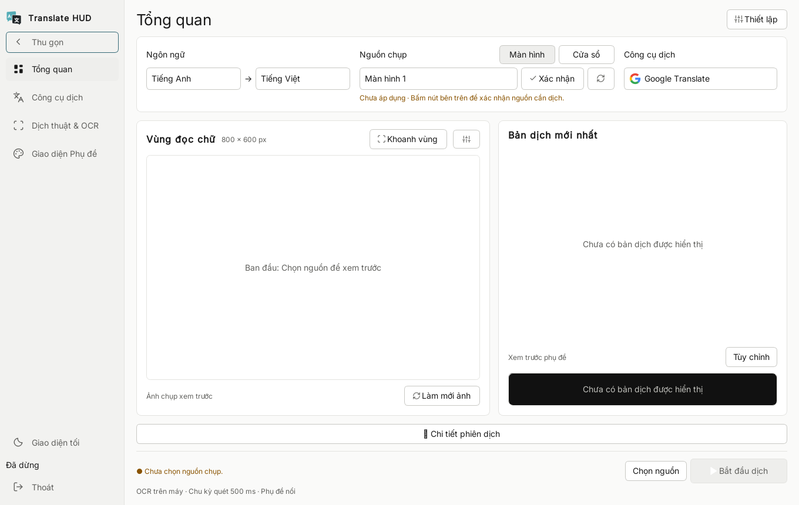
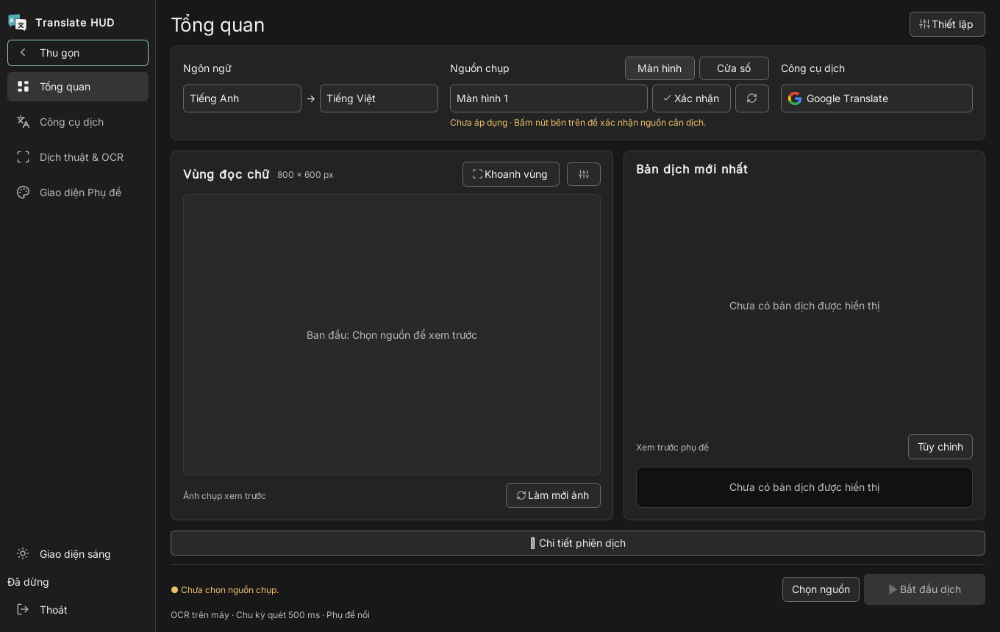
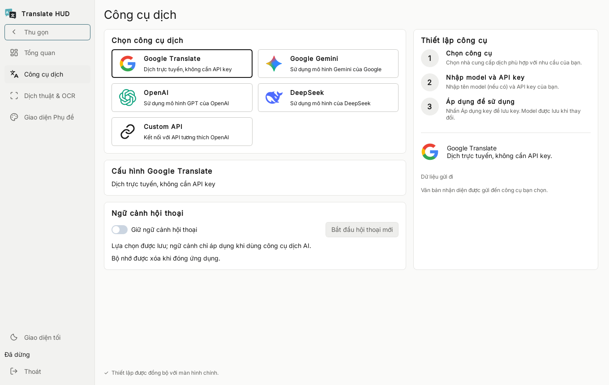
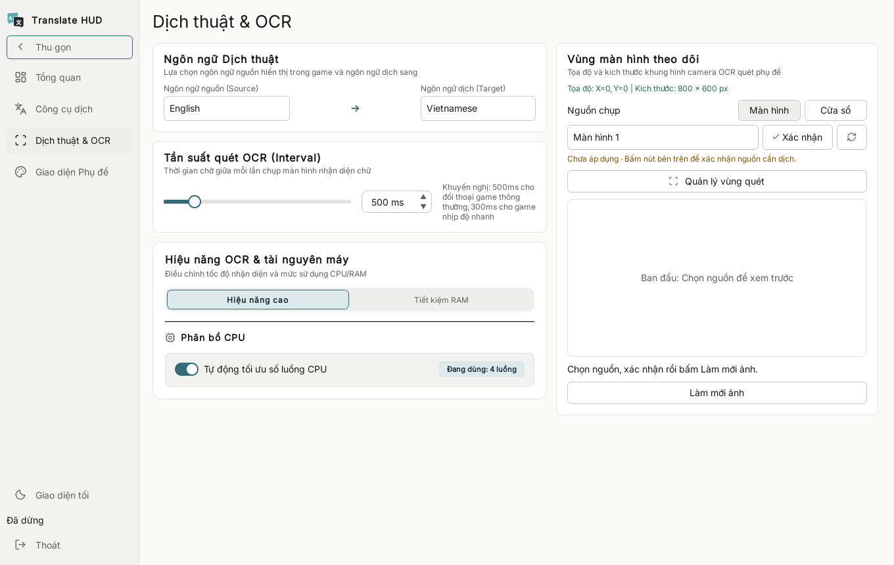
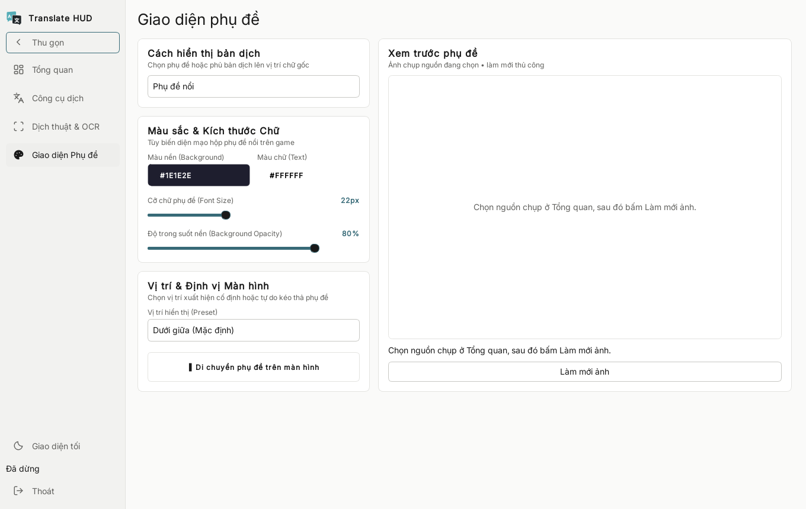
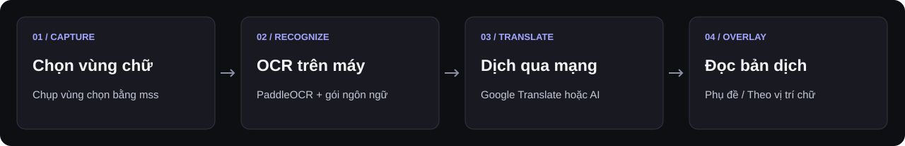

<p align="center">
  
</p>

<h1 align="center">Translate HUD</h1>

<p align="center">
  <strong>Đọc hiểu hội thoại game, ngay trên màn hình của bạn.</strong><br>
  Ứng dụng Windows nhận diện chữ trong vùng chọn và hiển thị bản dịch bằng overlay.
</p>

<p align="center">
  <code>Windows x64</code> · <code>Python 3.10</code> · <code>PyQt5</code> · <code>PaddleOCR</code>
</p>

<p align="center">
  <a href="#giao-diện">Giao diện</a> ·
  <a href="#tính-năng">Tính năng</a> ·
  <a href="#cài-đặt">Cài đặt</a> ·
  <a href="#sử-dụng">Sử dụng</a> ·
  <a href="#phát-triển">Phát triển</a>
</p>

---

## Giới thiệu

**Translate HUD** giúp bạn đọc chữ trên game hoặc ứng dụng mà không phải sao chép từng câu sang công cụ dịch. Kéo chọn vùng cần đọc, chọn ngôn ngữ và bắt đầu: ứng dụng chụp vùng màn hình, nhận diện chữ bằng OCR rồi đưa bản dịch lên phụ đề nổi hoặc lên vị trí chữ gốc.

Mặc định dùng **Google Translate, không cần API key**. Bạn cũng có thể chọn Google Gemini, OpenAI, DeepSeek hoặc Custom API tương thích OpenAI trong giao diện.

## Giao diện

### Bảng điều khiển

Trang **Tổng quan** tập trung ngôn ngữ, nguồn chụp, công cụ dịch, vùng đọc chữ và **Bản dịch mới nhất**. Bạn có thể đổi công cụ dịch ngay tại đây; nút **Bắt đầu dịch / Dừng dịch** cùng trạng thái luôn ở phía dưới.

Sidebar bên trái dẫn tới bốn trang: **Tổng quan**, **Công cụ dịch**, **Dịch thuật & OCR** và **Giao diện Phụ đề**. Có thể thu gọn sidebar thành biểu tượng và chuyển giao diện sáng/tối bằng nút ở gần cuối thanh.

<p align="center">
  <a href="assets/readme/dashboard.png">
    
  </a>
</p>

<details>
<summary><strong>Xem giao diện tối, công cụ dịch, thiết lập OCR và phụ đề</strong></summary>

### Giao diện tối

Chuyển sáng/tối từ sidebar; lựa chọn được lưu cho lần mở sau.



### Công cụ dịch

Chọn Google Translate hoặc nhà cung cấp AI bằng các thẻ công cụ. Các trường model, API key và base URL thay đổi theo công cụ đã chọn; phần hướng dẫn bên cạnh giải thích cách thiết lập.



### Dịch thuật & OCR

Thiết lập ngôn ngữ, chu kỳ quét, nguồn chụp và vùng màn hình cần theo dõi. Thẻ **Hiệu năng OCR & tài nguyên máy** cho phép chọn **Hiệu năng cao / Tiết kiệm RAM**, tự động tối ưu hoặc tự đặt số luồng CPU.



### Tùy biến phụ đề

Chọn **Phụ đề nổi** hoặc **Theo vị trí chữ**. Chỉnh màu nền, màu chữ, cỡ chữ, độ trong suốt và vị trí; xem trước ngay trong ứng dụng.



</details>

*Ảnh được dựng từ các widget của phiên bản mã nguồn hiện tại với cấu hình và danh sách nguồn mẫu, ở trạng thái dừng; không chụp nội dung màn hình hay gọi dịch vụ dịch. Banner và sơ đồ minh họa luồng dịch.*

## Tính năng

| Tính năng | Bạn có thể làm gì? |
| :--- | :--- |
| **Nguồn chụp linh hoạt** | Chọn màn hình hoặc cửa sổ game, rồi khoanh vùng chứa hội thoại hay chữ cần dịch. |
| **Điều khiển hằng ngày** | Đổi ngôn ngữ, xem ảnh chụp theo yêu cầu và theo dõi bản dịch đã hiển thị trên một màn hình. |
| **Giao diện sáng/tối** | Chuyển theme, thu gọn sidebar và điều hướng giữa bốn trang; bố cục tự sắp xếp theo kích thước cửa sổ. |
| **Ngữ cảnh hội thoại tùy chọn** | Công cụ AI có thể dùng hội thoại gần đây và trí nhớ nhân vật giới hạn trong RAM; mặc định tắt, chỉ dành cho chế độ phụ đề. |
| **Nhiều công cụ dịch** | Chọn Google Translate, Google Gemini, OpenAI, DeepSeek hoặc Custom API. |
| **Hai cách hiển thị** | Dùng phụ đề nổi hoặc bản dịch theo vị trí chữ gốc. |
| **Tùy biến phụ đề** | Điều chỉnh màu sắc, cỡ chữ 14–36 px, độ trong suốt và vị trí. |
| **Chủ động tần suất quét** | Đặt chu kỳ 100–3000 ms; mặc định 500 ms. Đây là chu kỳ quét, không phải cam kết độ trễ dịch. |
| **Điều chỉnh tài nguyên OCR** | Chọn hiệu năng cao hoặc tiết kiệm RAM, tự động tối ưu số luồng CPU hoặc cấu hình thủ công. |
| **Điều khiển khi chơi game** | Dùng phím tắt toàn hệ thống, thanh điều khiển nổi và biểu tượng khay hệ thống. |
| **Quản lý gói OCR** | Kiểm tra trạng thái các gói; tải thêm bộ nhận diện tiếng Trung và tiếng Hàn. |
| **Lưu API key** | Lưu bằng Windows DPAPI hoặc chỉ dùng trong phiên hiện tại. |

### Ngôn ngữ

| Vai trò | Hỗ trợ |
| :--- | :--- |
| **Nguồn OCR** | English, Japanese, Chinese, Korean |
| **Đích dịch** | Vietnamese, English |
| **Gói OCR đi kèm bản đóng gói đầy đủ** | English, Japanese |
| **Gói OCR tải thêm** | Chinese, Korean — cần cài trong trình quản lý gói ngôn ngữ |

## Cách hoạt động



OCR xử lý ảnh trên máy sau khi có đủ model. Phần dịch gửi **văn bản nhận diện được** đến công cụ bạn chọn và cần kết nối mạng. Thời gian phản hồi phụ thuộc vùng quét, CPU, mạng và nhà cung cấp dịch.

## Cài đặt

### Bản portable Windows x64

README này mô tả **mã nguồn hiện tại trên nhánh `develop`**. Gói kiểm thử ngày **01/11/2026** được tạo tại `dist/release-2026-11-01/TranslateHUD-2026.11.01-windows-x64.zip`; gói cũ có thể chưa có các thay đổi giao diện mới nhất. Đây là đường dẫn đầu ra cục bộ khi đóng gói, không phải liên kết tải trên GitHub. Để dùng giao diện trong ảnh, chạy mã nguồn hiện tại hoặc đóng gói lại theo hướng dẫn bên dưới.

1. Giải nén **toàn bộ** ZIP vào một thư mục; không chạy trực tiếp trong ZIP.
2. Mở `main.exe`, giữ thư mục `_internal` bên cạnh EXE. Không cần cài Python để dùng bản này.
3. Gói đã kèm OCR **English và Japanese**. Google Translate và các API dịch vẫn cần mạng; API key do bạn tự cấu hình.

Bản này dành cho kiểm thử portable. Kiểm tra end-to-end bằng chính EXE trên máy Windows sạch, với capture/OCR và dịch vụ thật, cần được xác minh riêng; không suy ra từ kiểm thử tự động hoặc việc ứng dụng mở được.

### Chạy từ mã nguồn

#### 1. Chuẩn bị môi trường

Dùng **Windows x64, Python 3.10 x64** và Git. Bộ thư viện PaddleOCR/PaddlePaddle được ghim phiên bản trong [requirements.txt](requirements.txt); nên tạo môi trường riêng bằng Python 3.10.

Chạy trong PowerShell:

```powershell
git clone https://github.com/DoThanhBinh09052004/Realtime_Translator_Sreen.git
cd Realtime_Translator_Sreen

py -3.10 -m venv .venv
.\.venv\Scripts\python.exe -m pip install -r requirements.txt
```

#### 2. Chuẩn bị model OCR

**Bản clone chỉ chứa metadata OCR, không chứa trọng số model.** Đường chạy ứng dụng hiện tại dùng trình quản lý gói và cần tài nguyên trong `assets/ocr/`. Chỉ cài thư viện Python chưa đủ để bắt đầu OCR.

Nếu chưa có model, khởi tạo English và Japanese để PaddleOCR tải vào cache trên máy:

```powershell
.\.venv\Scripts\python.exe -c "from paddleocr import PaddleOCR; [PaddleOCR(lang=lang, ocr_version='PP-OCRv4', use_angle_cls=False, show_log=False) for lang in ('en', 'japan')]"
```

Sau đó chuẩn bị model, từ điển và catalog. Lệnh dưới dùng thư mục cache mặc định của PaddleOCR; thay `--source-cache` nếu bạn đã cấu hình nơi lưu khác. Thư mục đầu ra `scratch/ocr-assets` phải chưa tồn tại.

```powershell
.\.venv\Scripts\python.exe tools/prepare_ocr_models.py `
  --source-cache "$env:USERPROFILE/.paddleocr" `
  --output scratch/ocr-assets `
  --pack-catalog assets/ocr/language-packs.json

Copy-Item -Path .\scratch\ocr-assets\* -Destination .\assets\ocr\ -Recurse -Force
```

Chỉ chạy lệnh sao chép khi công cụ chuẩn bị model hoàn tất thành công. Trọng số model được Git bỏ qua. Xem thêm [hướng dẫn chuẩn bị và đóng gói OCR](docs/testing/windows-ocr-bundle.md).

#### 3. Mở ứng dụng

```powershell
.\.venv\Scripts\python.exe main.py
```

## Sử dụng

1. Trên trang **Tổng quan**, chọn cặp ngôn ngữ ở hàng **Ngôn ngữ**. English/Japanese đã có model trong bản portable; Chinese/Korean cần cài thêm gói OCR tại **Dịch thuật & OCR**.
2. Trong **Nguồn chụp**, chọn **Màn hình** hoặc **Cửa sổ**, chọn nguồn rồi bấm **Xác nhận**. Nút biểu tượng làm mới cập nhật danh sách nếu vừa mở game; bấm **Đổi nguồn** khi cần chọn lại.
3. Bấm **Khoanh vùng**, chọn vùng chứa chữ. Nút biểu tượng thanh trượt ở góc thẻ **Vùng đọc chữ** mở **Quản lý vùng nâng cao** nếu cần nhiều vùng OCR. **Làm mới ảnh** cập nhật ảnh xem trước theo yêu cầu, không phải video liên tục.
4. Giữ **Google Translate** trong danh sách **Công cụ dịch** để bắt đầu không cần key. Muốn dùng AI, mở **Thiết lập** hoặc trang **Công cụ dịch** từ sidebar, chọn nhà cung cấp, model và áp dụng API key; Custom API cần thêm base URL tương thích OpenAI. Bấm **Tùy chỉnh** hoặc mở **Giao diện Phụ đề** để chọn cách hiển thị và chỉnh kiểu phụ đề.
5. Bấm **Bắt đầu dịch** khi trạng thái đã sẵn sàng. Khung **Bản dịch mới nhất** theo dõi cặp chữ gốc/bản dịch đã được đưa lên overlay; bên dưới có **Xem trước phụ đề**. Mở **Chi tiết phiên dịch** để xem nhật ký. Bấm **Dừng dịch** để kết thúc quét; ứng dụng không tự bắt đầu chụp khi vừa mở.

Trở về màn hình dịch bằng **Tổng quan** trên sidebar. Thay đổi thiết lập được đồng bộ giữa các trang. Khi thu nhỏ cửa sổ, nội dung có thể cuộn dọc; thanh bắt đầu/dừng vẫn nằm phía dưới.

Nếu cửa sổ nguồn đóng hoặc không còn chụp được, ứng dụng chờ nguồn; bạn vẫn có thể dừng dịch hoặc chọn lại nguồn. Với game exclusive fullscreen, thử cửa sổ hoặc borderless.

### Giữ ngữ cảnh hội thoại

Trong **Thiết lập → Công cụ dịch**, bật **Giữ ngữ cảnh hội thoại** nếu muốn thử dịch có ngữ cảnh với nhà cung cấp AI ở chế độ phụ đề. Tùy chọn này **mặc định tắt**; Google Translate và chế độ dịch theo vị trí chữ (blocks) dùng đường dịch thông thường.

Mỗi vùng phụ đề có trí nhớ riêng, giới hạn trong RAM. Ngữ cảnh và thông tin nhân vật được gửi cùng yêu cầu dịch; không có cuộc gọi phân tích AI riêng hay cuộc gọi sửa JSON bổ sung. Thử lại do lỗi truyền tải vẫn có thể phát sinh. Khi ngữ cảnh bật, nhà cung cấp AI nhận thêm hội thoại gần đây, không chỉ câu OCR hiện tại.

Khoanh cả nhãn người nói và lời thoại trong cùng vùng nếu có. OCR thiếu bằng chứng về người nói/người nghe vẫn có thể khiến xưng hô sai; tính năng chưa được đánh giá chất lượng ngữ nghĩa bằng API thật.

Bấm **Bắt đầu hội thoại mới** khi đổi game hoặc cảnh cần xóa ngữ cảnh, nhất là bên trong cùng một trình giả lập. Dừng rồi bắt đầu trên cùng nguồn giữ trí nhớ giới hạn trong RAM; đổi công cụ/model/endpoint, ngôn ngữ, nguồn, chế độ hiển thị hoặc bật/tắt ngữ cảnh sẽ đặt lại trí nhớ. Đóng ứng dụng xóa trí nhớ, không lưu cơ sở dữ liệu nhân vật. Nếu API không hỗ trợ metadata hợp lệ, ứng dụng có thể tiếp tục dịch bằng văn bản và ngữ cảnh gần đây trong phiên dịch vụ đó. Xem [hướng dẫn kiểm chứng ngữ cảnh](docs/testing/dialogue-context.md) để biết chi tiết vòng đời và các giới hạn.

### Phím tắt Windows

| Phím | Thao tác |
| :--- | :--- |
| <kbd>Ctrl</kbd> + <kbd>Alt</kbd> + <kbd>F8</kbd> | Bật / dừng dịch |
| <kbd>Ctrl</kbd> + <kbd>Alt</kbd> + <kbd>F9</kbd> | Chọn lại vùng quét |

Nếu phím tắt bị ứng dụng khác chiếm, dùng bảng điều khiển hoặc menu khay hệ thống. Đóng cửa sổ điều khiển có thể thu ứng dụng xuống khay; chọn **Thoát** để kết thúc.

### Khi gặp vấn đề

| Hiện tượng | Cách xử lý |
| :--- | :--- |
| Gói English/Japanese chưa sẵn sàng | Với mã nguồn, thực hiện bước chuẩn bị model OCR. Với bản đóng gói, kiểm tra đã chép đủ thư mục ứng dụng. |
| Không nhận được chữ | Kiểm tra ngôn ngữ nguồn, trạng thái gói và chọn lại vùng quét sát nội dung cần đọc. |
| Google Translate tạm dừng | Kiểm tra mạng và thông báo trạng thái trên màn hình dịch; dùng **Thử lại** khi nút xuất hiện. |
| Công cụ AI báo lỗi | Kiểm tra API key, model, hạn mức và base URL nếu dùng Custom API. |
| Overlay không hiện trên game | Thử chế độ cửa sổ hoặc borderless. Khả năng hoạt động ở exclusive fullscreen cần kiểm tra riêng từng game. |
| Overlay theo vị trí chữ không có trong bản ghi | Chế độ này có thể bị loại khỏi ảnh chụp hoặc bản ghi màn hình. |

Ứng dụng hoạt động bằng chụp màn hình và cửa sổ overlay; không có cơ chế can thiệp vào tiến trình game. Chất lượng OCR phụ thuộc phông chữ, độ tương phản và kích thước chữ.

## Phát triển

```text
main.py                 Khởi tạo và kết nối các thành phần
core/                   Cấu hình, worker, gói ngôn ngữ, xử lý hội thoại
engines/                OCR và các dịch vụ dịch
ui/                     Bảng điều khiển, overlay, chọn vùng, phím tắt
assets/ocr/             Catalog, manifest và tài nguyên OCR cục bộ
assets/readme/          Banner, sơ đồ và ảnh giao diện cho README
tests/                  Kiểm thử tự động
tools/                  Chuẩn bị model, đóng gói và công cụ kiểm tra
docs/testing/           Hướng dẫn xác minh các chức năng
```

### Chạy kiểm thử

```powershell
.\.venv\Scripts\python.exe -m pip install -r requirements-dev.txt
.\.venv\Scripts\python.exe -m pytest
```

Bộ kiểm thử mặc định dùng OCR và dịch giả lập, chặn mạng và chụp màn hình thật. Xem [cơ chế cô lập kiểm thử](docs/testing/isolation.md). Kiểm thử tích hợp với game, dịch vụ thật và bản đóng gói cần chạy riêng.

### Đóng gói Windows

Xem [hướng dẫn Windows OCR bundle](docs/testing/windows-ocr-bundle.md) để tạo môi trường build riêng, chuẩn bị model và chạy `tools/build_windows.ps1`. Bản one-folder phải được phân phối đầy đủ cùng tài nguyên, không chỉ riêng tệp `.exe`.

### Đóng góp

Bạn có thể [báo lỗi hoặc đề xuất tính năng](https://github.com/DoThanhBinh09052004/Realtime_Translator_Sreen/issues). Khi báo lỗi, ghi rõ phiên bản Windows/Python, công cụ dịch, ngôn ngữ nguồn và các bước tái hiện. Kiểm tra nhật ký, ảnh chụp trước khi đính kèm để tránh chia sẻ API key hoặc nội dung riêng tư.

---

<p align="center">
  <strong>Translate HUD</strong><br>
  Chọn vùng chữ. Đọc bản dịch. Tiếp tục cuộc chơi.
</p>
