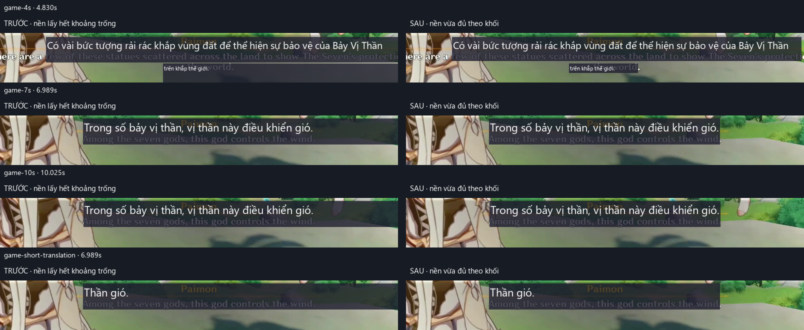

# Kiểm chứng khối overlay gọn theo nội dung

Ngày: 2026-10-24. Thiết kế: [compact block overlay](../superpowers/specs/2026-10-24-compact-block-overlay-design.md).

## Kết quả bố trí

Khối bắt đầu bằng khung nguồn đã clip, chỉ mở rộng khi bản dịch chưa vừa. Ưu tiên giữ cỡ chữ, mở rộng ngang tối thiểu, sau đó xuống dòng/tăng chiều cao vừa đủ; thiếu chỗ mới giảm font. Vật cản chéo được xét bằng cả các phương án rộng/thấp và hẹp/cao, giữ neo và phủ đủ nguồn khi các nguồn ban đầu không chồng nhau.

Một nền chữ nhật được vẽ cho mỗi khối. Cửa sổ trong suốt vẫn rộng bằng vùng OCR; vùng ngoài các khối không tô nền. Không thay đổi chế độ phụ đề cố định hoặc logic dịch/nhận diện lượt thoại.

## Đối chiếu trên frame thật



Baseline: `87d7bcd28bc646fb2740c9aaefcfc8b7ec1d2e8b`, trước Task 1. So sánh dùng code baseline được đọc bằng `git show`, không đổi checkout.

Nguồn video cục bộ: `tests/GENSHIN IMPACT Prologue All Cutscenes (Game Movie) 1080p 60FPS HD [2m55s-3m15s].mp4`. Transcript OCR thật đã ghi ở `scratch/dialogue-overlay-20261024/record/transcript.json`; fixture tracked `tests/fixtures/blocks/compact_game_dialogue.json` lưu SHA256 transcript, thời điểm, vùng crop, kích thước và khung nguồn đã qua `group_spans`.

Crop chuẩn hóa `(0.20, 0.75, 0.80, 0.89)`, resize `796×99`; thời điểm thực tế `4.8301578`, `6.9887515`, `10.0251174` giây. Các frame này không có nút Confirm bên cạnh vùng chữ được kiểm tra; ca vật cản được kiểm tra riêng bằng test tổng hợp. Bản dịch được điền cố định, không gọi API. Ca `game-short-translation` cố ý dùng “Thần gió.” để kiểm tra bản dịch ngắn trên khung nguồn thật.

Đơn vị bảng là logical pixel; geometry đối chiếu 1:1, font thực tế Segoe UI, cấu hình tối đa 22px. Nền giữ style 80% opacity để nhìn được phạm vi nguồn phía dưới.

| Frame / khối | Khung nguồn | Trước | Sau | Font trước → sau | Cắt chữ sau |
| --- | --- | --- | --- | --- | --- |
| 4.830s / 0 | 699×48 | 704×51 | 699×48 | 20 → 20 | Không |
| 4.830s / 1 | 138×14 | 470×38 | 138×19 | 11 → 11 | Không |
| 6.989s / 0 | 462×52 | 630×52 | 462×52 | 22 → 22 | Không |
| 10.025s / 0 | 460×52 | 629×52 | 462×52 | 22 → 22 | Không |
| Bản dịch ngắn / 0 | 462×52 | 630×52 | 462×52 | 22 → 22 | Không |

Frame đầu có nguồn OCR bị cụt ở mép crop và tách thành hai khối; ảnh đối chiếu giữ nguyên dữ liệu đó. Việc nhóm tên Paimon vào câu, khung cao, hoặc sai nội dung OCR không được sửa bởi thay đổi bố trí này. Nền bán trong suốt có thể cho thấy chữ gốc xuyên qua theo cấu hình độ mờ hiện tại.

Lệnh dựng lại (video là file cục bộ, không tracked):

```powershell
.venv/Scripts/python.exe tools/render_block_layout_preview.py --fixture tests/fixtures/blocks/compact_game_dialogue.json --video "tests/GENSHIN IMPACT Prologue All Cutscenes (Game Movie) 1080p 60FPS HD [2m55s-3m15s].mp4" --baseline-ref 87d7bcd --out scratch/compact-block-overlay
```

Kết quả chi tiết nằm tại `scratch/compact-block-overlay/metrics.json`, ảnh từng frame và `comparison.png`. Công cụ chỉ đọc video/fixture/git baseline và ghi thư mục output; không đọc khóa, lưu config, mở ứng dụng, tải model hoặc gọi dịch vụ.

## Automated tests

Chạy qua `.venv/Scripts/python.exe -m pytest` với `TEMP`/`TMP` và `--basetemp` riêng cho mỗi lượt, ngoài repo; xem [isolation.md](isolation.md). Đặt `QT_QPA_FONTDIR=C:\Windows\Fonts` cho offscreen trên Windows để dùng font hệ thống thay cho thư mục font đóng gói bị thiếu.

- Baseline trước sửa: **463 PASS**, exit 0.
- RED Task 1: 2 test nền/chiều rộng thất bại như dự kiến; sau thêm biên/va chạm: **5 FAIL, 9 PASS** trên code cũ.
- GREEN Task 1: **19 PASS**, exit 0, gồm bố trí và hình học.
- RED Task 2: **3 FAIL** vì chưa có công cụ đối chiếu; test vẽ nền đã PASS sau Task 1 nên không cần sửa widget.
- Focused cuối Task 2: **26 PASS**, exit 0, gồm bố trí, hình học, nền thực tế và tool.
- Full suite trước review: **479 PASS**, exit 0, **54.84 giây**.
- Full suite sau sửa finding review: **481 PASS**, exit 0, **56.50 giây**.

Các test xác minh khung ngắn, mở rộng tối thiểu (sai số tối đa 1 logical pixel), chiều cao tối thiểu, font ưu tiên, nguồn thấp, nguồn vốn chồng nhau, vật cản ngang/dưới/chéo, DPI 1.25, crop biên, vùng nhỏ, tiếng Việt và CJK. Test ảnh xác minh alpha phủ đủ nguồn và bằng 0 ngoài khối, cả sau đổi nội dung/style. Test CLI lỗi video chạy trong subprocess vì lượt chạy chung Qt/native codec từng exit `0xC0000008` ở teardown dù các assertion PASS; sau tách theo vòng đời CLI, focused suite exit 0.

## Quyết định khi triển khai

1. Tái sử dụng checkout `develop` hiện có, chỉ stage file của task theo hướng dẫn workspace/kế hoạch. Đổi lại, commit nằm chung nhánh cục bộ cho đến khi người dùng tích hợp.
2. Dùng ledger/brief/log tương đương trong `scratch/compact-overlay-execution` thay Bash skill scripts, vì Git Bash đã bị lỗi `NtCreateDirectoryObject` trong phiên. Kết quả và quyết định được giữ ở tài liệu này; không có ledger do script Bash tự sinh.
3. Dùng font Windows qua biến môi trường cho kiểm chứng offscreen. Đo ngoại tuyến vẫn có thể khác desktop thực ở DPI hoặc font fallback khác.

## Review và giới hạn

Reviewer độc lập `gpt-6-astra`, fresh context, kiểm tra hai commit `87d7bcd..c5468ae`: không có Critical/Minor, có một Important về khung nguồn lồng nhau khiến bản dịch bên trong bị bỏ mất. Reviewer tự chạy focused suite 26 PASS, thêm 100 ca ngẫu nhiên không chồng nguồn đều đạt phủ nguồn/biên/không giao nhau; phép đo tổng hợp khoảng 5ms/10 khối, 20ms/30 khối không chứng minh vấn đề hiệu năng chặn bàn giao.

Đã thêm regression cho khung lồng nhau và hai khung trùng nhau: **2 FAIL trước sửa → PASS sau sửa**. Nhánh nguồn vốn chồng nhau dùng lại lối thoát mở rộng/trừ vật cản, rồi bắt đầu từ một khung nhỏ ở vùng trống và áp dụng phép đo vừa đủ. Chỉ trường hợp nguồn vốn chồng nhau mới được dời neo để giữ bản dịch; không dời các nguồn ban đầu tách rời. Focused sau sửa: **28 PASS**, exit 0; full suite cuối **481 PASS**, exit 0. Không dispatch vòng review thứ hai theo quy trình Native. Dựng lại ảnh thật sau sửa cho cùng SHA256 với ảnh đối chiếu đã lưu. Không có finding Minor bị hoãn.

Các phần reviewer chưa thể kết luận được xử lý như sau:

- Đối số `font_family` khác mặc định vốn đo bằng font tùy chọn nhưng vẽ Segoe UI từ trước thay đổi này. Giữ hành vi cũ, vì caller sản phẩm hiện dùng mặc định; caller tự gọi font khác vẫn có giới hạn đã biết.
- Live capture exclusion/compositor/DPI/font fallback không được xác nhận qua offscreen; native code không đổi. Cần thử desktop thực nếu muốn kết luận phần đó.
- Chất lượng OCR/nhóm khối, độ trễ dịch và hàng chờ cũ không thay đổi; lỗi giữ bản dịch cũ vẫn có thể tồn tại.
- Các thay đổi riêng của người dùng được giữ nguyên và nằm ngoài review này; chúng chưa được review độc lập trong đợt này.

Ảnh tĩnh xác nhận kích thước và cách vẽ Qt, không xác nhận live capture exclusion, hiệu năng OCR/API, nhịp chuyển câu hoặc lỗi giữ bản dịch cũ. Không thay đổi các file/config đang được chỉnh sẵn trong workspace. Không merge hoặc push.
